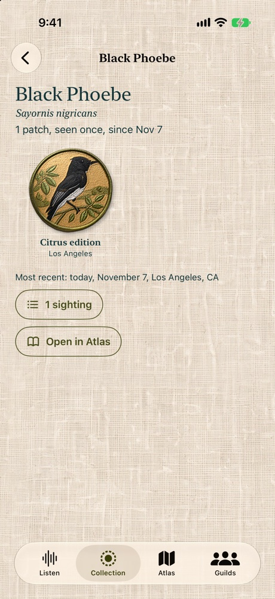
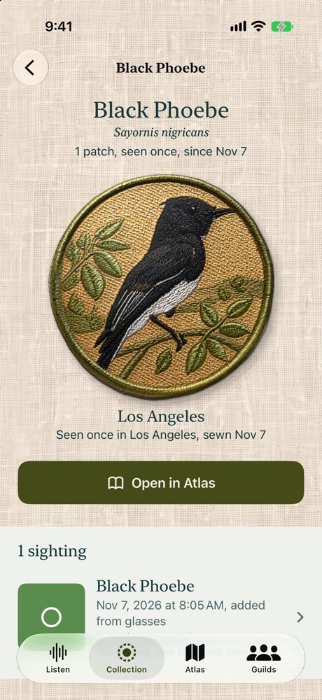
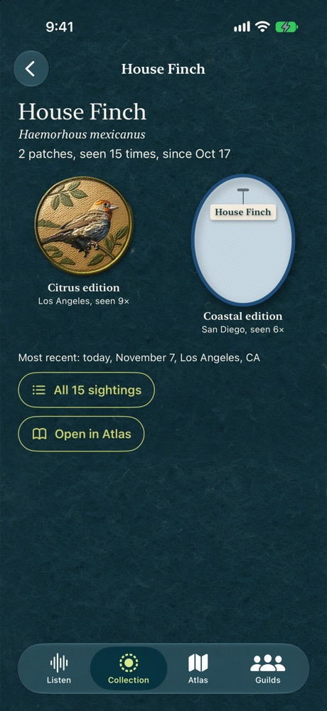
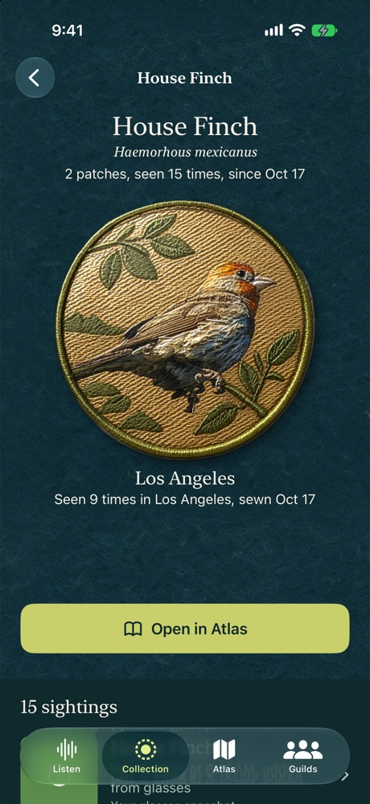

# Species page, issue #179

`before/` holds the pre-change species page from `78a7ad1`, on the dedicated BJ-179 iPhone 17 Pro simulator (iOS 27.2). Each of one patch (Black Phoebe), several patches (House Finch), and no patch (Canada Goose) is captured in light and dark, at default and AX5 text sizes. Dates are the live fixture dates; names, counts and the routing are real app views.

The redesign keeps one patch at 286 pt, matching the patch page's 330 pt footprint minus its 22 pt inset on each side. Several editions use the same large patch in a horizontal snapping carousel. Accessibility text uses a vertical reading column instead. Patches keep their normal tap, lift and peek actions. The Atlas button is full width and filled, followed by all the species' sightings in a lazy list on matte paper. That list uses scientific name consistently, even when older sightings carry a different common name in their stored species ID.

The old species-level All sightings button and route scope are gone. `PatchSightingsView` remains for the paper card and patch peek, which still link to one patch's sightings.

To reproduce after installing the desired build:

```sh
docs/screenshots/179/capture.sh <your-simulator-UUID> after
```

The script captures 12 screenshots and restores the simulator's text size to default and appearance to dark. It uses only in-memory fixtures. At AX5, scroll down to inspect the rest of the reading layout and action/list; the first viewport deliberately doesn't shrink the patch or text to fit.

`after/` contains the matching 12 screenshots after the redesign. Reviewed one/several/no-patch layouts in light and dark, including AX5 wrapping and the vertical reading layout. The targeted Gallery UI tests passed navigation into the patch, Atlas, and a sighting; the Swift Testing accessibility cases passed at default and AX5, including sightings stored under two labels for the same scientific name.

The dedicated capture simulator was deleted after verification.

| Example | Before | After |
|---|---|---|
| One patch, light |  |  |
| Several patches, dark |  |  |

| Scenario | Light, default | Dark, default | Light, AX5 | Dark, AX5 |
|---|---|---|---|---|
| One patch | [before](before/one-light-large.jpg) / [after](after/one-light-large.jpg) | [before](before/one-dark-large.jpg) / [after](after/one-dark-large.jpg) | [before](before/one-light-accessibility-extra-extra-extra-large.jpg) / [after](after/one-light-accessibility-extra-extra-extra-large.jpg) | [before](before/one-dark-accessibility-extra-extra-extra-large.jpg) / [after](after/one-dark-accessibility-extra-extra-extra-large.jpg) |
| Several patches | [before](before/several-light-large.jpg) / [after](after/several-light-large.jpg) | [before](before/several-dark-large.jpg) / [after](after/several-dark-large.jpg) | [before](before/several-light-accessibility-extra-extra-extra-large.jpg) / [after](after/several-light-accessibility-extra-extra-extra-large.jpg) | [before](before/several-dark-accessibility-extra-extra-extra-large.jpg) / [after](after/several-dark-accessibility-extra-extra-extra-large.jpg) |
| No patch | [before](before/none-light-large.jpg) / [after](after/none-light-large.jpg) | [before](before/none-dark-large.jpg) / [after](after/none-dark-large.jpg) | [before](before/none-light-accessibility-extra-extra-extra-large.jpg) / [after](after/none-light-accessibility-extra-extra-extra-large.jpg) | [before](before/none-dark-accessibility-extra-extra-extra-large.jpg) / [after](after/none-dark-accessibility-extra-extra-extra-large.jpg) |
